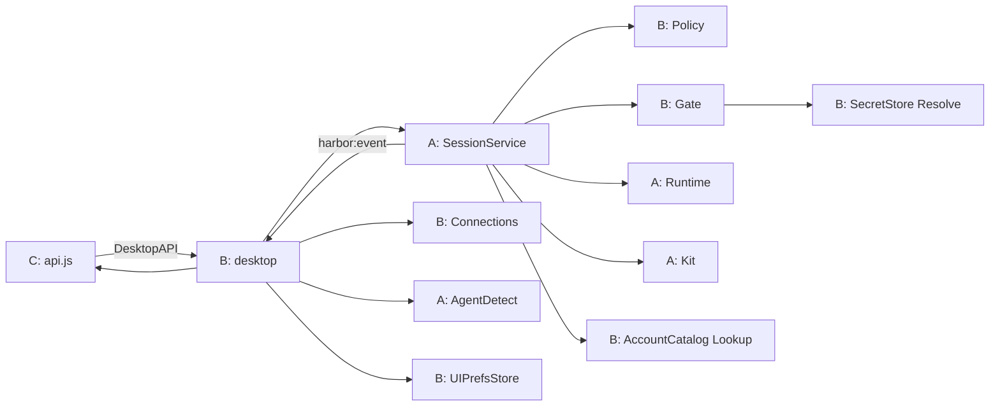

# Agent Harbor — V1 整体架构、模块拆分与分工

| 项 | 内容 |
|---|---|
| 文档版本 | v2.0（**分支 feat/page-design-full：全量 PAGE-DESIGN**） |
| 日期 | 2026-10-25 |
| 分支目标 | 按 [PAGE-DESIGN](PAGE-DESIGN.md) **完整**实现导航与各屏；**不裁** OAuth / clone / PTY；**不按交付排期砍范围** |
| 产品屏 | [PAGE-DESIGN](PAGE-DESIGN.md) |
| **接口唯一来源** | [CONTRACT](CONTRACT.md) v1.2 |
| 屏级绑定表 | [PAGE-API-MAP](PAGE-API-MAP.md) |
| 包级细则 / 替身 | [MODULE-DESIGN](MODULE-DESIGN.md) |
| 任务卡 | [TASK-SPLIT-ABC](TASK-SPLIT-ABC.md) |

本文是 **V1 实施总纲**：架构怎么分、模块谁拥有、模块间只经哪些接口交互。字段与方法签名以 CONTRACT 为准；本文不重复粘贴全部 DTO。

---

## 1. 设计命题（不变）

| 平面 | 位置 | 持有真实密钥 |
|---|---|---|
| **控制面** | 宿主机 Go + 桌面 UI | 能（仅 Secrets / Gate） |
| **执行面** | 隔离环境内 Agent | **不能** |

出站（模型 HTTPS、MCP）必须经 Harbor Gate；UI 永不直连上游、不回显 Key。

---

## 2. 逻辑分层

```text
┌─────────────────────────────────────────────────────────────┐
│ L5  体验     PAGE 壳：HOME / 向导 / 模型 / 工具 / 设置 / 工作台 │
│             Onboarding · 扩权 Modal · 阻断 · 权限一览         │
├─────────────────────────────────────────────────────────────┤
│     适配     frontend/api.js ↔ Wails DesktopAPI（B 生成绑定）   │
├─────────────────────────────────────────────────────────────┤
│ L4  编排     Orchestrator：多会话锁、生命周期、扩权挂起、事件 seq │
├─────────────────────────────────────────────────────────────┤
│ L3  控制面   Policy · Secrets · Gate · 账号目录 · UI 偏好文件   │
├─────────────────────────────────────────────────────────────┤
│ L2  隔离     Runtime：Health / Create / Exec / Destroy         │
├─────────────────────────────────────────────────────────────┤
│ L1  执行面   Kit + Agent 进程 + 工作区（无密钥）                │
└─────────────────────────────────────────────────────────────┘
```

依赖铁律：

1. L5 **只**调 DesktopAPI + 订阅 `harbor:event`。  
2. L4 经窄接口用 L3/L2，不把 Secrets.Resolve 交给编排。  
3. L1 只拿 Gate URL + Sentinel。  
4. 新增能力优先扩 DesktopAPI / SessionService / Gate，**不新造平行控制面**。

---

## 3. 模块拆分与所有权

### 3.1 包 / 目录矩阵

| 模块 | 路径 | 负责人 | 唯一职责 | 对外接口（消费方可见） | 不做 |
|---|---|---|---|---|---|
| **contracts** | `internal/contracts` | A 主笔 / B 复核 | 可序列化 DTO、错误码、事件形状 | 纯数据 | IO、状态机 |
| **desktop** | `internal/desktop` + `main` | B | Wails 生命周期、绑定、目录面板、事件桥、偏好落盘 | `DesktopAPI` | 再造会话状态机 |
| **frontend** | `frontend/src` | C | 壳与各页、api/mock、演示文案 | 仅调 `api.js` | 手改 bindings、改 `internal/` |
| **orchestrator** | `internal/orchestrator` | A | 会话表、上限=2、同工作区冲突、Stop/Destroy、扩权挂起、事件 seq | `SessionService`（扩展见 CONTRACT） | 存 Key、解析 MCP 协议 |
| **runtime** | `internal/runtime` | A | 隔离探测 Health、私有 HOME、进程树 | `Runtime` | 账号、UI |
| **kits** | `internal/kits` | A | Detect / Build LaunchSpec | `Kit` | 读 Secrets |
| **policy** | `internal/policy` | B | 工作区、host 白名单、记住主机、mount 校验 | `PolicyBuilder` + 记住主机读写 | 网络转发 |
| **gate** | `internal/gate` | B | 模型反代、MCP、Sentinel、审计回调、扩权触发点 | `Gate` / `Connections` | Agent 生命周期 |
| **secrets** | `internal/secrets` | B | 凭据与账号元信息 | `SecretStore` + `AccountCatalog` | UI 回显 Key |
| **security** | `security/` + A 记录 | A | 真实隔离/泄密验收 | 证据 | 用 mock 冒充通过 |

### 3.2 模块交互（只经接口）



| 调用 | 允许 | 禁止 |
|---|---|---|
| UI → Go | DesktopAPI 方法 | 直接 import 业务包、读本地 Key 文件当上游 |
| Orch → Secrets | 仅 `AccountCatalog.Lookup` | `Resolve` / `Put` |
| Gate → Secrets | `Resolve` | 把明文放进事件 |
| Kit → Gate | 无；由 Orch 映射 URL/Sentinel | Kit 读 Secrets |
| Runtime → Gate | 无；只消费 AllowedTCP | Runtime 做业务鉴权 |

### 3.3 前端内部模块（C）

| 模块 | 路径 | 职责 |
|---|---|---|
| 壳路由 | `main.js` / `index.html` | 导航、灯、引导、阻断、偏好键 |
| 视图 | `views/*` | 单页 UI；经 `ctx` + `api` |
| 传输 | `api.js` / `mock-api.js` / `live-api.js` | 同名方法；mock∥live 可替换 |
| 事件 | `session-events.js` | seq 合并、输出尾 |

---

## 4. 本分支范围（全量 PAGE-DESIGN）

对照 PAGE-DESIGN §2–§5：**全部做**；实现可先 mock，再换 live。

| 能力 | 本分支 | 说明 |
|---|---|---|
| 壳导航 HOME/模型/工具/设置；工作台不强占主入口 | **做** | 有 running 时顶栏会话切换 + 可进工作台 |
| Onboarding / 阻断 | **做** | 失败不可跳过 |
| HOME 多会话 | **做** | running≤2；同工作区禁双开；销毁确认；再次开始 |
| Wizard 真四步 | **做** | 工作区(含 clone/direct)→Agent→模型→工具(可跳过) |
| 模型自由 OpenAPI | **做** | 名+地址+Key；列表无未配置占位；编辑/删除 |
| 工具双轨 | **做** | OAuth/SSO **或** Token |
| 工作台 | **做** | 边界条、当前模型切换、权限一览、扩权 Modal、**PTY 区**、右侧摘要 |
| 设置全项 | **做** | 按 PAGE §5.8；无「关闭隔离」 |
| UIPrefs | **做** | 侧栏收缩等 |

`main` 上的「裁 OAuth/clone/PTY」**不适用于本分支**。P0 I 证据仍可并行，但不作为砍 UI 的理由。

---

## 5. 接口文档入口

| 内容 | 文档 |
|---|---|
| DesktopAPI 全方法、DTO、事件、错误码、行为表 | **[CONTRACT.md](CONTRACT.md)** |
| 哪一屏调哪些方法 | [PAGE-API-MAP.md](PAGE-API-MAP.md) |
| 后端窄接口（SessionService / Gate / …） | CONTRACT § 后端 + MODULE-DESIGN |

**变更纪律**：改字段先改 CONTRACT → 同步 `internal/contracts` → B `wails3 generate` → C mock → 再写真实现。禁止只改前端猜字段。

---

## 6. ABC 并行分工（按模块）

```text
合同（本文 + CONTRACT）已定
    ├─ A：contracts DTO · Orchestrator 多会话/扩权/Destroy · Runtime.Health 暴露
    ├─ B：DesktopAPI 绑定占位→实现 · Connections 扩展 origin · Policy 记住主机
    │     · 权限一览组装 · UIPrefs 落盘 · generate bindings
    └─ C：mock 全方法 · 壳/页接真字段 · 扩权 Modal · 权限一览 UI · demos
合流：方法名 / JSON / 错误码一致后再换 live
```

| 角色 | 立即开工 | 依赖对方完成才算交付 |
|---|---|---|
| **A** | 扩展 `SessionService`：`List`/`Destroy`/`ResolvePermission`；多会话锁；Runtime.Health 语义供桌面 | Gate 扩权回调真触发（B） |
| **B** | `wails3 generate`；DesktopAPI 去 `UNIMPLEMENTED`；Catalog 列表/删除；Overview；Prefs；origin；Gate→permission 事件 | Orch 多会话（A）联调 HOME/上限 |
| **C** | **按 PAGE-DESIGN 全屏实现**（可 mock）；四步向导、双轨工具、PTY UI、扩权/一览 | live 真 OAuth/PTY/多会话由 A/B 接线 |

**本分支优先级**：**PAGE-DESIGN 完整体验 > 排期**；live 未就绪用 mock，不删屏。

---

## 7. 与长期文档关系

| 文档 | 角色 |
|---|---|
| **PAGE-DESIGN** | **本分支产品真源**；逐屏对照实现 |
| ARCHITECTURE | 控制/执行面；本分支 UI 所需能力都要有契约入口 |
| DESIGN / MVP-2D3P | 参考；本分支不因两天裁剪删功能 |

---

## 8. 修订

| 日期 | 说明 |
|---|---|
| 2026-10-25 | 初版定案：取消冻结会依赖；V1 范围与模块所有权一次写死 |
| 2026-10-25 | 复核：明确 Health/Accounts/扩权三段所有权；P0 优先于 V1 |
| 2026-10-25 | **v2.0**：分支 `feat/page-design-full` 改为全量 PAGE-DESIGN（含 OAuth/clone/PTY） |
